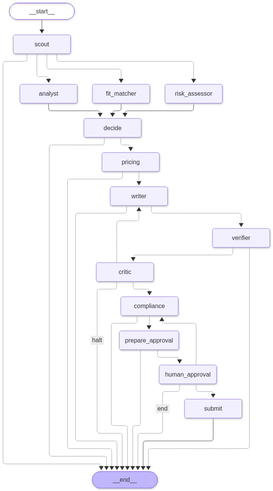

# GigBid

A freelancer copilot built from LangGraph agents. It finds jobs, judges whether they are worth the Connects, writes proposals where every claim points at real portfolio evidence, and handles client replies. **Nothing reaches a client until the freelancer approves it in the web UI.**

AI-4016 R&D assignment, individual work by Abdul Majeed (23P-3038).

- Live app: see `docs/DEPLOYMENT.md` (reviewer login is in the private submission comment)
- Repo: https://github.com/Do-Or-D1E/gigbid
- Portfolio MCP server: `docker run -i --rm ghcr.io/do-or-d1e/gigbid-portfolio-mcp:latest --owner ai_ml` (see `mcp_servers/portfolio/README.md`)



## What it does

1. A worker runs saved searches on a schedule, deduplicates and queues new jobs.
2. For each job the **Job Analyst**, **Risk Assessor** and **Fit Matcher** run in parallel (LangGraph `Send`). A deterministic decision node picks bid, watch or skip from their typed reports and the thresholds in `agent/config.yaml`.
3. For a bid, the **Pricing Strategist** quotes from market statistics and the live Connects price, the **Writer** drafts, the **Claim Verifier** checks every claim against portfolio evidence and removes what it cannot prove, the **Critic** sends weak drafts back (at most twice) and the **Compliance Guard** enforces the platform policy pack.
4. The graph stops at `interrupt()`. The approval screen shows the draft with the evidence behind each claim, the risk report, the price rationale and a `dry_run` preview of exactly what will be sent and what it costs. Approve, edit (diffed into style memory, re-checked) or reject with a reason.
5. Client replies start the conversation graph: intent, slots from the calendar, a drafted reply, the same approval gate.

Everything the agents touch is an MCP tool: three servers of our own (portfolio, marketplace, workspace) plus the official Upwork MCP server for live mode, behind one marketplace port (`marketplace.mode: gigsim | upwork_live`).

## Results

All numbers below are generated by `uv run python -m evals.runners.make_tables` from `evals/results/` (CI checks that they trace). The data is described in `docs/DATA_CARD.md`: synthetic personas and gold labels, with market prices calibrated on real Kaggle Upwork data and real postings in the live stream.

### Retrieval and proposals: V0 against the shipped design

<!-- results:start headline -->
_pending_
<!-- results:end -->

### RAG variants (all dev jobs with gold evidence)

<!-- results:start rag -->
_pending_
<!-- results:end -->

Ablation of the shipped pipeline, one component at a time:

<!-- results:start ablation -->
_pending_
<!-- results:end -->

### Decisions, cost and latency on the dev set

<!-- results:start decisions -->
_pending_
<!-- results:end -->

### Single agent vs prebuilt supervisor vs hand-built graph

<!-- results:start multiagent -->
_pending_
<!-- results:end -->

### Tool granularity

<!-- results:start tools -->
_pending_
<!-- results:end -->

### Prompt injection: attack success before and after defences

<!-- results:start injection -->
_pending_
<!-- results:end -->

### Signature extension X2: proposal A/B test in GigSim

<!-- results:start ab -->
_pending_
<!-- results:end -->

## Public traces

See `docs/TRACES.md` for LangSmith public links: a skipped scam, an approved proposal, a Critic loop and a crash-and-resume.

## Run it

```bash
uv sync                       # Python 3.12, dependencies pinned in uv.lock
cp .env.example .env          # add GROQ_API_KEY (free) and optionally OPENAI_API_KEY, LANGSMITH_API_KEY
make dev                      # API with GigSim + MCP in-process on :8000, web on :5173
make test                     # unit, contract, MCP, GigSim, data tests + Playwright
make eval                     # regenerates evals/results/*.json and the tables above
docker compose -f infra/docker-compose.yml up --build   # everything as separate services
```

Model profiles live in `agent/config.yaml`: `open` (open-weight models on Groq, the default and the deployed profile), `open_qwen` (second open configuration), `local` (Ollama) and `paid` (gpt-4o-mini, optional). Every node's model is set there, never in code.

## Repository map

| Path | What is there |
|---|---|
| `agent/` | state, typed hand-offs, nodes, both graphs, prompts (one file per node), memory rules, MCP client, config |
| `rag/` | loaders, chunkers, indexes, variants V0 to V8, claim verification |
| `mcp_servers/` | portfolio, marketplace (GigSim and Upwork adapters), workspace |
| `apps/api`, `apps/web` | FastAPI backend with SSE run streams; React + TypeScript UI with Playwright tests |
| `worker/` | Arq worker: scheduled scouting, run execution, event polling, recovery |
| `gigsim/` | our marketplace simulator (frozen by checksum in CI) |
| `evals/` | runners, datasets (dev only), results that every number here cites |
| `docs/` | architecture, ADRs, tools, runbook, data card, extension, report |

## Stack (pinned in `uv.lock` and `apps/web/package-lock.json`)

Python 3.12, LangGraph 1.2, langchain-mcp-adapters 0.3, MCP Python SDK 1.30, FastAPI 0.163, Postgres 16 + pgvector, Redis + Arq, LangSmith, model2vec potion-base-8M embeddings, fastembed MiniLM cross-encoder, React 18 + Vite + TypeScript, Playwright.
