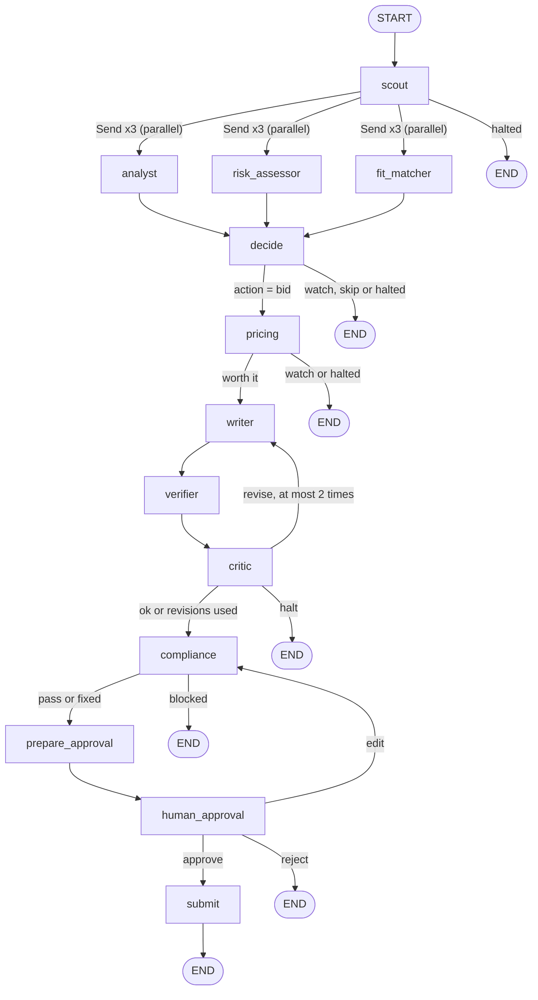
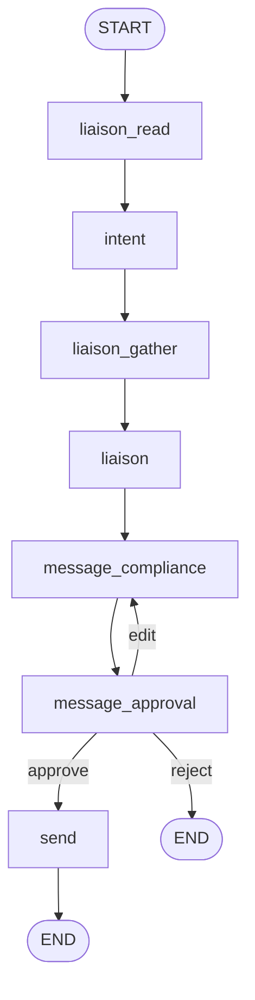

# GigBid architecture

## Purpose

GigBid is a freelancer copilot. It watches a marketplace for new jobs, decides which ones are worth a bid, drafts a proposal that only claims what the freelancer's portfolio proves, and stops for a human decision before anything is sent or any Connects are spent. It also helps with client messages once a proposal gets a reply.

It is built as two LangGraph graphs, three MCP servers of our own, a Postgres database, and a FastAPI app with a React front end. The marketplace is behind a port, so the same graph runs against our own simulator (GigSim) or against live Upwork.

Related documents: `docs/TOOLS.md` (every MCP tool), `docs/RUNBOOK.md` (how to run and what to do when things break), `docs/DATA_CARD.md` (data), `docs/adr/` (decisions).

## The two graphs

Node names below are the exact names used in `agent/graphs/bid_graph.py` and `agent/graphs/conversation_graph.py`.

### Bid graph (one thread per job)



Notes on the diagram:

- `analyst`, `risk_assessor` and `fit_matcher` run in parallel. `decide` runs when all three have finished.
- "halted" means the state status is one of `needs_attention`, `marketplace_down`, `blocked`, `dead_letter` (the `HALT` tuple in `agent/nodes/_base.py`). Every wrapped node returns at once when the status is already in `HALT`.
- `human_approval` calls LangGraph `interrupt()`. The graph stops there and the checkpoint keeps the whole state until the user decides.
- `build(..., interrupt=False)` is used by the evals. It ends the graph at `prepare_approval`, so evals never send anything.

### Conversation graph (one thread per client conversation)



Each step except the last also goes to END when the status is in `HALT`. `message_approval` is an `interrupt()` too.

## Why each agent exists

Models are chosen per node in `agent/config.yaml` (`nodes:`). Small tier for frequent cheap work, strong tier for writing and judgement.

| Agent or node | Graph node | Why it exists | What it uses |
|---|---|---|---|
| Scout | `scout` (intake). Scheduled searches run in `worker/tasks.py` | Finds new jobs, drops duplicates, and checks the job text for injected instructions before any model reads it. Separating it keeps scheduled scanning away from the expensive analysis. | MCP `search_jobs`, `get_job`. No model call in `scout_intake`. Pattern screen in `agent/guardrails.py` |
| Job Analyst | `analyst` | Turns a free-text post into a structured `JobSpec` (requirements, budget, questions). | Small model. No MCP access |
| Risk Assessor | `risk_assessor` | Judges client quality and scam signals (off-platform contact, free work, upfront fees). The pattern screen is authoritative for injection flags. | MCP `get_client_history`, small model |
| Fit Matcher | `fit_matcher` | Maps each requirement to portfolio evidence and scores fit. It searches only proof types (`rag.proof_types`: case study, repo, review, cv, upload). Past proposals are not proof (ADR 0004). | MCP `search_evidence`, small model |
| Decision (not an agent) | `decide` | Bid, watch or skip by fixed rules over the three reports. Deterministic on purpose: a job post cannot talk it into bidding, and a wrong decision can be traced to one node and one threshold (ADR 0003). Thresholds are in `decision:` in the config. | Code only |
| Pricing Strategist | `pricing` | Proposes a bid from market statistics and client spend. Code then enforces the user's floor and checks that expected value is at least 3 times the Connects cost in USD. The Connects cost always comes from the marketplace quote. | MCP `get_pricing_stats`, `quote_connects`, `get_connects_balance`, small model |
| Proposal Writer | `writer` | Writes the cover letter and screening answers from the evidence. Reads promoted style rules and outcome insights from long-term memory. | Strong model, memory store |
| Claim Verifier | `verifier` | Splits the draft into claims and checks each against the evidence. Unsupported claims are removed or rewritten. A lexical guard downgrades claims whose numbers are not in the evidence. Plans and commitments are not experience claims (ADR 0007). Reports unsupported counts before and after. | Small model, `rag/verify.py` |
| Critic | `critic` | Reviews grounding, personalisation, opening, coverage and length. Sends the draft back to `writer` at most `writer.max_revisions` (2) times. Some checks (generic opening, length, unsupported claims left) are deterministic and cannot be argued away. | Strong model |
| Compliance Guard | `compliance` | Enforces the active policy pack. A deterministic scrub runs first (contact details, guarantees, disallowed links) and cannot be overruled. The model handles what patterns cannot see. It can block. | Small model, `agent/policy.py` |
| Client Liaison | `liaison_read`, `intent`, `liaison_gather`, `liaison`, `message_compliance`, `message_approval`, `send` | Handles client messages: classify intent, fetch free calendar slots or evidence, draft a reply, check it, and wait for approval before sending. Off-platform and fee requests are forced to the `scam_signal` intent by a regex. | MCP `list_messages`, `free_slots`, `search_evidence`, `send_message`, `create_interview_hold`. Models: `intent` small, `liaison` strong |

`prepare_approval`, `human_approval` and `submit` finish the bid graph. `prepare_approval` builds the approval payload and two `dry_run` previews (draft payload and Connects cost). `submit` creates the draft and submits it with deterministic idempotency keys.

## The marketplace port

The graph never talks to a marketplace directly. It calls MCP tools, and the Marketplace MCP server picks an adapter from config.

```
agent/mcp_client.py  McpGateway.call()
        |  (MCP, Streamable HTTP or in-process)
mcp_servers/marketplace/server.py   14 tools, idempotency, dry_run, rate limit, audit
        |  _adapter(): reads marketplace.mode
        +-- adapters/gigsim.py       REST calls to GigSim (/v1/...)
        +-- adapters/upwork_live.py  calls the official Upwork MCP server
```

- The interface is `MarketplaceAdapter` in `mcp_servers/marketplace/adapters/base.py`. Both adapters implement the same 14 methods.
- `marketplace.mode` in `agent/config.yaml` is `gigsim` or `upwork_live`. The env var `MARKETPLACE_MODE` overrides it.
- `adapters/gigsim.py` retries with backoff, honours `Retry-After` on 429, and raises `MarketplaceUnavailable` when GigSim stays down. 4xx answers become `MarketplaceRejected` and are not retried. With `GIGSIM_BASE_URL=inproc` it calls the GigSim ASGI app inside the same process.
- `adapters/upwork_live.py` maps the port onto the Upwork MCP tool names in `adapters/upwork_tools.yaml`. That map is unverified: no Upwork account was available to list the real tools. It has not been run end to end. In live mode `submit_proposal` never submits. It returns `awaiting_user_confirmation_on_upwork`, so the user confirms the draft on Upwork. `get_pricing_stats` falls back to GigSim's historical statistics because Upwork has no such tool in the map. `get_events` returns an empty list.
- Account tokens are per user in `marketplace_accounts`, encrypted with Fernet (`TOKEN_ENC_KEY`). For GigSim the token is a fixed dev token such as `gs-ai_ml-dev`.
- Errors cross the MCP boundary as text prefixes: `MARKETPLACE_UNAVAILABLE`, `MARKETPLACE_REJECTED`, `IDEMPOTENCY_CONFLICT`, `FORBIDDEN`, `NOT_CONNECTED`. `McpGateway` turns `MARKETPLACE_UNAVAILABLE` into the Python exception `MarketplaceDown`.

## The MCP surface

| Server | Where | Tools | Notes |
|---|---|---|---|
| Portfolio (ours) | `mcp_servers/portfolio/server.py`, port 8101 | `search_evidence`, `get_case_study`, `list_skills`, 4 resources, 3 prompts | Read only. Also runs standalone over stdio (see `mcp_servers/portfolio/README.md`) |
| Marketplace (ours) | `mcp_servers/marketplace/server.py`, port 8102 | 14 tools (11 read, 3 write) | Adapter behind the port |
| Workspace (ours) | `mcp_servers/workspace/server.py`, port 8103 | `free_slots`, `create_interview_hold`, `create_email_draft` | Mock calendar and mailbox, allowed by the brief |
| Upwork official | `https://mcp.upwork.com/mcp` | Not listed by us | Used only by `adapters/upwork_live.py` in live mode. Drafts only |
| GitHub official | `https://api.githubcopilot.com/mcp/` | Not listed by us | Listed in `mcp.servers.github` in the config. Not called by any code yet (see `docs/TOOLS.md`) |

`docs/TOOLS.md` has the full tool table, annotations, auth, allowlists and trust notes.

Transport: `mcp.transport` is `http` (Streamable HTTP to the three servers) or `inproc` (memory-stream sessions to the same FastMCP objects, used on Vercel and in tests). Identity and the trace id travel in HTTP headers or in the request `_meta`.

## Stores

One Postgres database holds the state of the system. The retrieval index is built in process from the portfolio files.

| Store | What it holds | Where defined |
|---|---|---|
| LangGraph checkpointer | Graph state after every step, per thread. Used for interrupts, recovery and replay | `AsyncPostgresSaver`, set up in `agent/runner.py` `graphs()` |
| LangGraph store (long-term memory) | Promoted style rules and outcome insights | `AsyncPostgresStore`, namespaces in `agent/memory/store.py` |
| `runs` | Durable run queue: status, attempts, heartbeat, error, metrics, trace id | `agent/db.py` |
| `run_events` | Every node event of a run, tailed by the SSE endpoint | `agent/db.py` |
| `approvals` | One row per thread waiting for or holding a human decision | `agent/db.py` |
| `spans` | Execution trace: one row per model call and per tool call, with tokens, cost and latency | `agent/db.py`, written by `agent/tracing.py` |
| `audit_log` | Every MCP tool call. Append only: a trigger rejects UPDATE and DELETE | `agent/db.py` |
| `users`, `user_settings`, `saved_searches`, `marketplace_accounts`, `jobs`, `pipeline`, `uploads`, `marketplace_cursor` | Product data. Every query is scoped by user id | `agent/db.py` |
| `mcp_idempotency`, `workspace_holds`, `llm_ledger` | Created on demand by the marketplace server, the workspace server and the spend ledger | `mcp_servers/*`, `agent/llm.py` |
| pgvector table `evidence_chunks` | Vector column `vector(256)` for portfolio chunks. The extension and table are created by the schema. At the moment retrieval runs in process with numpy (`rag/index/store.py`) and no code reads or writes this table | `agent/db.py` |

Memory namespaces in the LangGraph store (`agent/memory/store.py`):

- `("style", user)`: promoted style rules, key is the feature name.
- `("style_window", user)`: the last N edit feature sets. These are candidates only. The writer does not read them.
- `("outcome", user)`: promoted insights per job category, key is the lower-cased category.

## State, execution trace and long-term memory

These three are kept apart on purpose.

| | State | Execution trace | Long-term memory |
|---|---|---|---|
| Code | `agent/state.py` | `agent/tracing.py` | `agent/memory/` |
| Scope | One job or one conversation, right now | One run | One user, across runs |
| Content | Job, reports, draft, decision, totals for steps and tokens | Every tool name, arguments, result, model, tokens, cost, latency (PII masked) | Only promoted knowledge |
| Written by | Nodes, through reducers | `tracing.add()` from `llm.py` and `mcp_client.py` | `record_edit` and `refresh_outcomes`, through `promotion_rules.py` |
| Fed back to the model | Yes, as needed | Never | Yes: the writer reads rules and insights |
| Stored in | Postgres checkpointer | `spans` table and LangSmith | LangGraph store |

Promotion rules (`agent/memory/promotion_rules.py`, numbers from `agent/config.yaml`):

- Style: an edit feature becomes a rule only when it appears in at least `memory.style.promote_after` of the last `memory.style.window` edits.
- Outcome: insights for a category are written only after at least `memory.outcome.min_outcomes` final outcomes in that category.
- Raw tool output is never written to memory.

State reducers sit on every key that parallel branches write (`evidence`, `critiques`, `edits`, `steps`, `tokens`, `cost_usd`, `status`, `timings` and others).

## How a run executes

A run is one execution step of a graph thread: a new bid analysis, a resume after a human decision, a continuation after the marketplace came back, a replay, or a conversation turn. Code is in `agent/runner.py`.

1. The API or the scheduler calls `runner.enqueue()`. It inserts a row in the `runs` table (status `queued`) and an event.
2. `apps/api/dispatch.py` hands the run id to a worker. With `REDIS_URL` set, it enqueues an Arq job. Without Redis (serverless) the run just stays queued in Postgres.
3. `runner.claim()` is a single `UPDATE ... WHERE run_id = (SELECT ... FOR UPDATE SKIP LOCKED)`. It takes a run in `queued` or `retry`, or a `running` run whose `heartbeat_at` is older than `STALE_S` (180 s). Two workers cannot claim the same run.
4. `runner.execute()` opens an `McpGateway` for the user, builds the graph config (thread id, gateway, trace metadata, recursion limit 80) and streams the graph with `stream_mode=["updates", "custom"]`.
5. Every event goes to `run_events`. The heartbeat is refreshed when more than 15 s have passed since the last one and a chunk arrives.
6. An interrupt writes a row to `approvals` (status `pending`), and the run ends as `awaiting_approval`. The user's decision (`POST /api/approvals/{thread_id}/decision`) flips the row from `pending` in one atomic UPDATE, then enqueues a `bid_resume` run. That run resumes the graph with `Command(resume=decision)`.
7. At the end the run row gets status, error, metrics and a LangSmith reference. Spans are saved to `spans`. `_sync_job` mirrors the outcome into the `jobs` and `pipeline` tables that the UI reads.

Live progress: `apps/api/streaming.py` tails `run_events` and sends Server-Sent Events. A page refresh or a second tab sees the same stream. In inline (serverless) mode, the stream request itself claims a queued run and executes it.

Workers:

- Arq worker (`worker/arq_worker.py`, docker compose). `run_job` claims and executes one run. Cron jobs: `scout_all` every 10 minutes (each saved search still obeys its own interval) and `sweep` every 2 minutes (`recover()` plus `drain()`).
- Serverless tick (`worker/tasks.py` `tick()`, called through `/api/worker/tick`). It scouts due searches, polls marketplace events, recovers parked runs and drains up to 4 runs inside a time budget.

## Failure handling

| Failure | What happens | Where |
|---|---|---|
| A node raises a transient error | LangGraph `RetryPolicy` per node: `LLM_RETRY` (2 attempts, backoff 1 s x2) for model nodes, `TOOL_RETRY` (3 attempts, backoff 0.5 s x2) for `scout`, `prepare_approval`, `submit`. Not retried: `MarketplaceDown`, `BudgetExceeded`, `KeyError`, `TypeError`, `ValueError`. Each node also has a timeout (60 to 180 s) | `agent/graphs/bid_graph.py`, `conversation_graph.py` |
| Model call fails | `llm.call()` tries the primary model twice (when the error looks retryable), then the profile's fallback model twice. After that it raises | `agent/llm.py` |
| Marketplace is down | `GigSimAdapter` retries, then raises `MarketplaceUnavailable`. The server returns `MARKETPLACE_UNAVAILABLE`. `McpGateway.call()` raises `MarketplaceDown` without hammering. The node wrapper re-raises it, so the checkpoint keeps that node pending. `runner.execute()` sets the run to `waiting_marketplace` | `adapters/gigsim.py`, `agent/mcp_client.py`, `agent/nodes/_base.py`, `agent/runner.py` |
| Marketplace comes back | `worker/tasks.py` `recover()` probes with `get_connects_balance`. If it answers, every `waiting_marketplace` run goes back to `queued` and continues from its checkpoint | `worker/tasks.py` |
| Any other exception in a run | Status `retry` while attempts are below 3, then `dead_letter`. The job row is marked `dead_letter` | `agent/runner.py` |
| A worker dies mid-run | The run stays `running`. When its heartbeat is older than 180 s, `claim()` takes it again and the graph continues from the last checkpoint | `agent/runner.py` |
| Step or token budget | Per thread: `budgets.max_steps_per_thread` (40) and `budgets.max_tokens_per_thread` (60000). The node wrapper sets status `needs_attention` and the graph stops | `agent/nodes/_base.py` |
| Spend cap | Before every billed call `llm._check_budget()` compares the ledger total with `llm.billed_cap_usd` (2.00). Over the cap raises `BudgetExceeded` and the node returns `needs_attention`. Free providers (`billed: false`) are not capped | `agent/llm.py` |
| Duplicate action after a retry | Write tools take idempotency keys. The same key and request returns the stored result. A different request with the same key is refused | `mcp_servers/marketplace/server.py`, GigSim |

Known limit: the heartbeat is written only when a stream chunk arrives. A single node that runs longer than 180 s without any event could be reclaimed while still running. Node timeouts are at most 180 s and writes are idempotent, so the effect is wasted work, not a double submit.

The UI shows a banner while `/api/health` reports the marketplace as down. The health probe calls `get_policy` through the MCP gateway and caches the answer for 10 s.

## Deployment modes

### Docker compose (`infra/docker-compose.yml`)

Services: `postgres` (pgvector/pgvector:pg16), `redis`, `gigsim` (8081), `mcp-portfolio` (8101), `mcp-marketplace` (8102), `mcp-workspace` (8103), `api` (8000), `worker` (Arq), `web` (3000, nginx), and `ollama` behind the `local-models` profile. All Python services share the image `gigbid-python-base` (`infra/docker/python-base.Dockerfile`). The API reaches the MCP servers over Streamable HTTP with a signed service token. Runs are queued in Redis and executed by the worker.

### Vercel single function (`api/index.py`, `vercel.json`)

One Python function serves the API, the built web app, GigSim and the three MCP servers. `api/index.py` sets defaults: `INPROC_SERVICES=1`, `MCP_TRANSPORT=inproc`, `GIGSIM_BASE_URL=inproc`, `GIGBID_LEDGER_PG=1`. With `INPROC_SERVICES=1`, `apps/api/main.py` mounts GigSim at `/gigsim` and the MCP servers at `/mcp/portfolio`, `/mcp/marketplace` and `/mcp/workspace`. The agent reaches them in process. The MCP servers are still reachable over HTTP with bearer auth.

There is no Redis and no long-running worker. Queued runs are executed by the SSE stream request that watches them, or by `/api/worker/tick`. A GitHub Actions workflow (`.github/workflows/tick.yml`) calls the tick every 3 hours with `CRON_SECRET`, because Vercel Hobby cron runs only once a day. Function `maxDuration` is 300 s. See ADR 0005 and ADR 0006.
